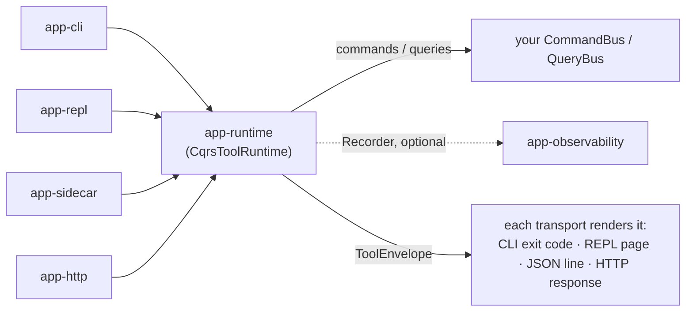

# devx-micro

An [Nx](https://nx.dev) workspace for shared, reusable TypeScript libraries, published under the
`@devx-micro` npm scope.

> **Status:** early. Licensed under [MPL-2.0](https://github.com/devx-micro/devx-micro/blob/main/LICENSE). A secrets scan of the full git history
> (`gitleaks git`) found nothing on 2026-11-17; re-run it before making this repository public.

## Packages

| Package                                                                                                      | What it is                                                                                                                             |
| ------------------------------------------------------------------------------------------------------------ | -------------------------------------------------------------------------------------------------------------------------------------- |
| [`@devx-micro/app-runtime`](https://github.com/devx-micro/devx-micro/tree/main/libs/app-runtime)             | One dispatch path for a NestJS CQRS app, answering every transport with a uniform result envelope.                                     |
| [`@devx-micro/app-cli`](https://github.com/devx-micro/devx-micro/tree/main/libs/app-cli)                     | The command-line transport: `runOneShot` runs one operation from `argv`.                                                               |
| [`@devx-micro/app-repl`](https://github.com/devx-micro/devx-micro/tree/main/libs/app-repl)                   | The interactive transport: a prompt with completion, help and session variables.                                                       |
| [`@devx-micro/app-sidecar`](https://github.com/devx-micro/devx-micro/tree/main/libs/app-sidecar)             | The JSON-lines transport, server (`runJsonLinesDriver`) and client (`SidecarClient`).                                                  |
| [`@devx-micro/app-http`](https://github.com/devx-micro/devx-micro/tree/main/libs/app-http)                   | Renders that envelope over HTTP: exit code to status mapping, and `unwrap` to a response or `HttpException`.                           |
| [`@devx-micro/app-main`](https://github.com/devx-micro/devx-micro/tree/main/libs/app-main)                   | The process entry point: `defineApp` builds the CLI, REPL, sidecar and HTTP entry points and the `argv` mode dispatch.                 |
| [`@devx-micro/app-observability`](https://github.com/devx-micro/devx-micro/tree/main/libs/app-observability) | The recorder port, observation record shape, content addressing (RFC 8785 + SHA-256) and pure inference-run logic. No storage, no I/O. |

Each package README documents installation, usage and behaviour. The full API reference is generated
with TypeDoc (see [Documentation](#documentation)).

### How they fit together



Dependencies point one way: each transport (`app-cli`, `app-repl`, `app-sidecar`, `app-http`) →
`app-runtime` → `app-observability`. The transports do not depend on each other. `app-main` sits above them: it composes `app-cli`, `app-repl` and `app-sidecar` into one process entry point and is not a transport.
See [docs/architecture.md](docs/architecture.md) for the design decisions behind this.

## Getting started

Requirements: Node `>=22.16` (`.tool-versions` pins 24.19.0) and npm.

```bash
npm install
npm run build        # nx run-many -t build
npm test             # vitest, per package
npm run typecheck
npm run lint
npm run format:check
```

Run a single package's task with Nx, e.g. `npx nx test app-runtime` or
`npx nx build app-observability`. `npm run graph` opens the project graph.

### Layout

```
libs/   one package per directory, @devx-micro/<name>
apps/   runnable apps (none yet)
docs/   hand-written docs; docs/api is generated and git-ignored
```

Each library has `src/index.ts` (the public API), `src/lib/*.ts`, colocated `*.spec.ts` files, and
builds with SWC to `dist/libs/<name>`.

## Documentation

| What                          | Where                                           |
| ----------------------------- | ----------------------------------------------- |
| Per-package guides            | `libs/*/README.md`                              |
| Architecture and design rules | [docs/architecture.md](docs/architecture.md)    |
| Contributing                  | [CONTRIBUTING.md](CONTRIBUTING.md)              |
| API reference (TypeDoc)       | `npm run docs`, then open `docs/api/index.html` |

`npm run docs` builds one HTML site covering all three packages, using each package's `README.md`
as its landing page. `npm run docs:check` runs the same validation without writing output, which is
useful in CI.

## Rules

- A package here depends on `@nestjs/*`, `@devx-micro/*` and third-party packages, **never** on
  anything from a consuming repository. A shared library that imports its consumer has become part of it.
- Source, specs, comments and docs carry no names, paths or hosts from any private repository.

## License

[MPL-2.0](https://github.com/devx-micro/devx-micro/blob/main/LICENSE)
