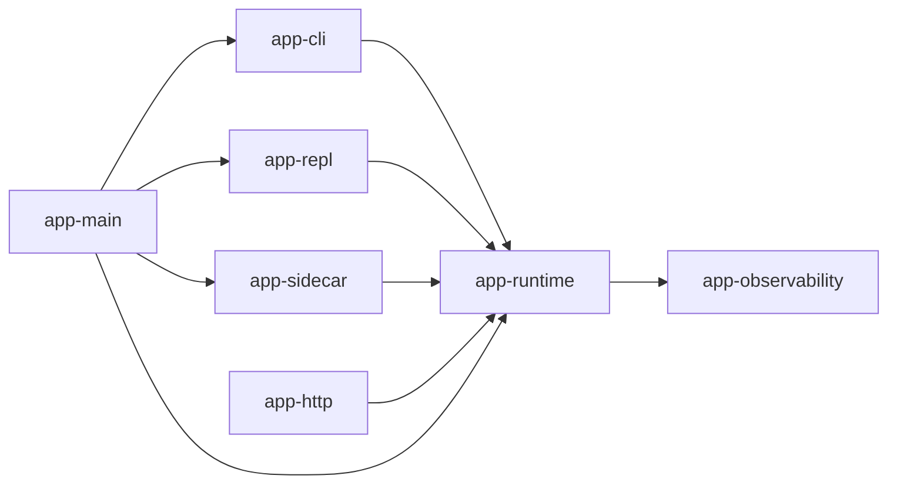
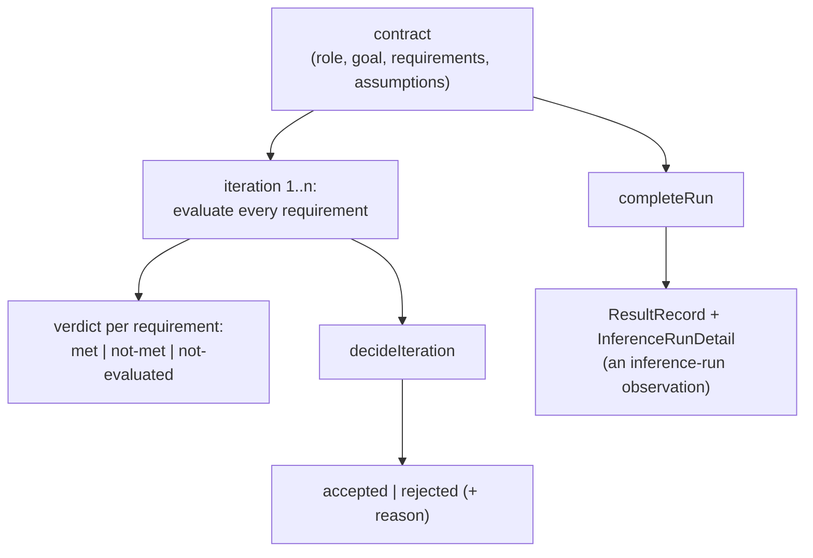

# Architecture

This workspace holds seven small libraries that together give a NestJS CQRS application a uniform,
observable, multi-transport tool surface.

A package may depend only on packages to its right (and on `@nestjs/*` and third-party packages).
The four transports do not depend on each other. `app-main` is not a transport: it sits above `app-cli`, `app-repl` and `app-sidecar` and composes them into one process entry point (`defineApp`), so it depends on all three and on `app-runtime`. Nx tags all seven `scope:shared`, `type:util`.

## Design rules

### 1. Shared libraries never import their consumer

Anything a library needs from the application is expressed as a **port**: an interface declared in
the library and implemented by the consumer. Examples:

- `ToolBus` (`app-runtime`): anything with `execute(request): Promise<unknown>`. Nest's real
  `CommandBus`/`QueryBus` satisfy it, and so does a test double.
- `SessionBoardPort` (`app-runtime`): REPL session variables, bound by the app. Without one,
  every operation still runs.
- `Recorder`, `InferenceRecorder` and `Clock` (`app-observability`): storage and time, bound by the
  app's composition root. `noopRecorder` is the safe default.

### 2. One envelope, many transports

Every transport calls `CqrsToolRuntime.dispatch`, which resolves (never rejects) to a `ToolEnvelope`.
Transports differ only in how they _render_ it: the CLI (`app-cli`) prints it and returns `exitCode`;
the sidecar (`app-sidecar`) writes a line; the REPL (`app-repl`) pretty-prints it; HTTP maps it to a
status (`app-http`).

Three statuses exist because there are three outcomes: `success`, `error`, and `incomplete` (a
resumable sequence that stopped part-way). Collapsing `incomplete` into either of the others loses
the one thing a caller needs: where to resume.

`app-http` is a separate package so the status mapping is written once (several apps
duplicating it is how the CLI comes to answer exit code 2 while HTTP answers 500) without making
`app-runtime` depend on `@nestjs/common`.

### 3. Refuse, don't coerce

Input validation fails loudly and by name: unknown keys are refused, numbers are parsed rather than
coerced, and a non-object input is a usage error rather than a handler failure. A caller's mistake
must never look like a server fault. `error.code` is the contract; message text is for humans.

### 4. Observation never alters the result

The runtime records each dispatch through a `Recorder`, but:

- every recorder, clock and mapping error is swallowed;
- the recorder is awaited (a one-shot CLI exits as soon as it prints) but only up to a bound
  (`BoundedRecording`), after which a circuit breaker stops asking for a cooldown;
- **no argument values** are recorded, only key names and the error code.

### 5. Content addressing is exact

A `ContentId` is `1-` plus 32 hex characters of SHA-256, over RFC 8785 canonical JSON for records and
exact UTF-8 bytes for text. `canonicalJson` throws on anything with no JSON form, because a hash
input that silently changes shape is an integrity hole. An ID names bytes, not a type: store the kind
alongside it.

### 6. Absent is not zero

Unmeasured durations, latencies and confidences are **omitted**, never `0`. Validators and emitters
both honour this; the validators cannot tell a measured `0` from a fabricated one, so it is the
emitter's responsibility.

## Inference-run model (`app-observability`)

- A requirement's identity (`requirementId`) hashes normalised text, so reformatting does not change
  the claim.
- An iteration is accepted only if nothing is `not-met` and at least one requirement is `met`.
- There is no built-in evaluator, so by default everything is `not-evaluated` and nothing is accepted.
  Provide `RequirementEvaluator`s to decide requirements.
- Incomplete contracts and duplicate requirements can never be accepted. Whether they are refused
  before dispatch or observed and recorded as failures is controlled by `ContractEnforcement`
  (default `'observe'`).

## Build and test

- Build: `@nx/js:swc` to `dist/libs/<name>` (CommonJS), with `LICENSE` copied alongside.
- Test: Vitest per package, with `tsconfig.base.json` `paths` derived into aliases
  (`vitest.shared.ts`) so tests exercise source, never a stale build.
- `typecheck` covers both lib and spec tsconfigs, and `test` depends on it.
